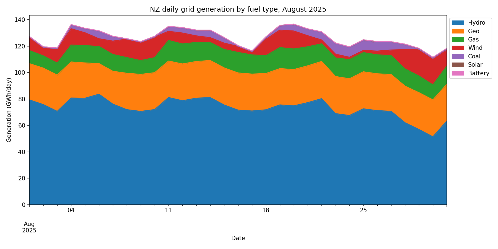

# NZ Electricity Generation Data Analysis

Python analysis of New Zealand half-hourly grid generation data from the Electricity Authority (EMI).

**Status: work in progress**

## Background
In a RESE421 tutorial, I analysed one day of half-hourly generation data (22 August 2025) in Excel. This project extends that to the full month of August 2025 using Python, with data checks and visualisation.

## Data
- Source: Electricity Authority EMI, Generation output (`202508_Generation_MD.csv`)
- One row per generating unit per day; columns TP1–TP50 are half-hour trading periods (kWh)
- 2,807 rows, 31 days

## What `explore.py` does
1. Reads the CSV with pandas
2. Checks fuel labels and finds inconsistent codes (`HYD` vs `Hydro`, `GEO` vs `Geo`, `SOL` vs `Solar`). Each was checked against `Tech_Code` before merging. `ELE` units are batteries (`Tech_Code` = `BAT`), grouped as Battery
3. Sums TP1–TP50 to get daily generation per unit, then totals by date and fuel type (GWh)
4. Plots a stacked area chart

## Result


August 2025 total: about 3,914 GWh (about 126 GWh per day). Hydro 58%, geothermal 22%, gas 11%, wind 7%, coal 2%.

## Data issues found
- Inconsistent fuel codes (fixed as above)
- No coal generation records on 1–3 August
- The two `GEO`-coded geothermal units have 41 daily records between them instead of 62, so at least one unit has missing days (to check)
- Diesel and wood units recorded zero generation all month

## Next steps
- [ ] Read the data day by day to simulate a data stream
- [ ] Automatic checks: missing values, duplicate rows, units with missing days, sudden jumps
- [ ] Evening peak (TP43) comparison across the month
- [ ] Add more months
- [ ] Interactive dashboard

## How to run
```
pip install pandas matplotlib
python3 explore.py
```